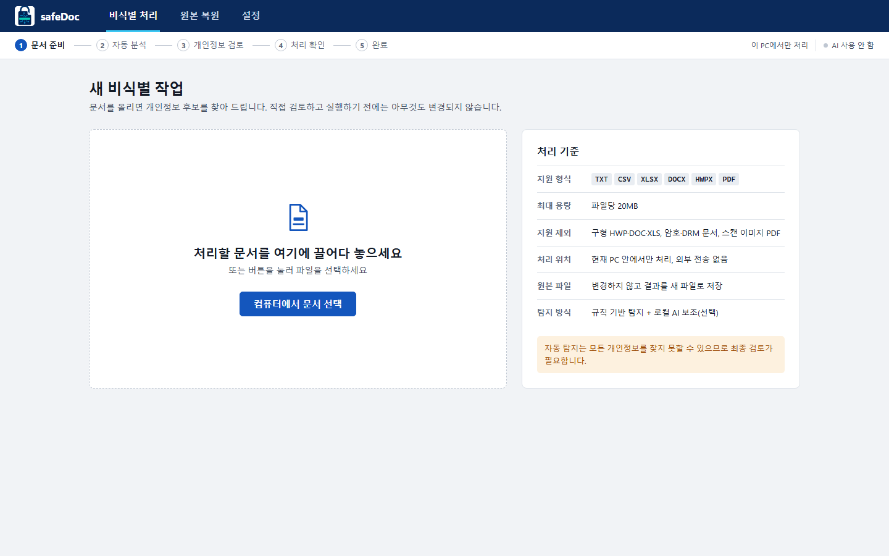
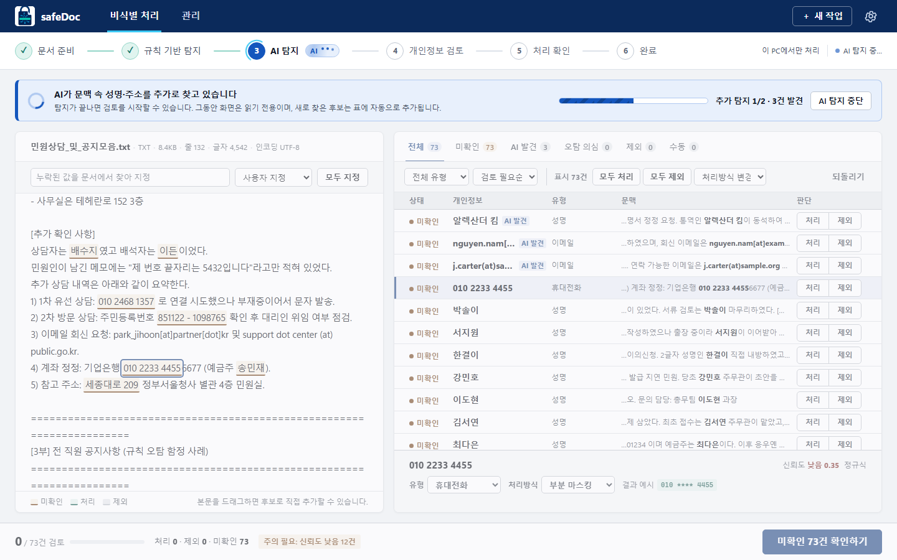
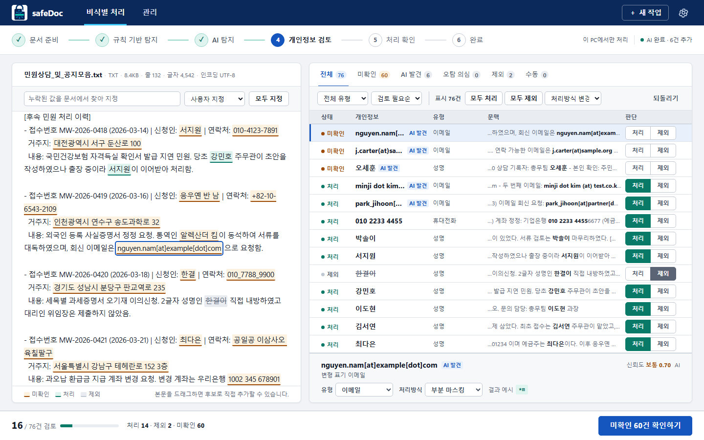
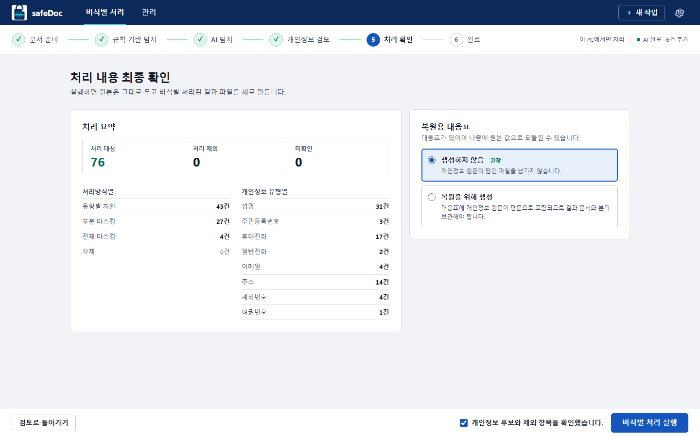
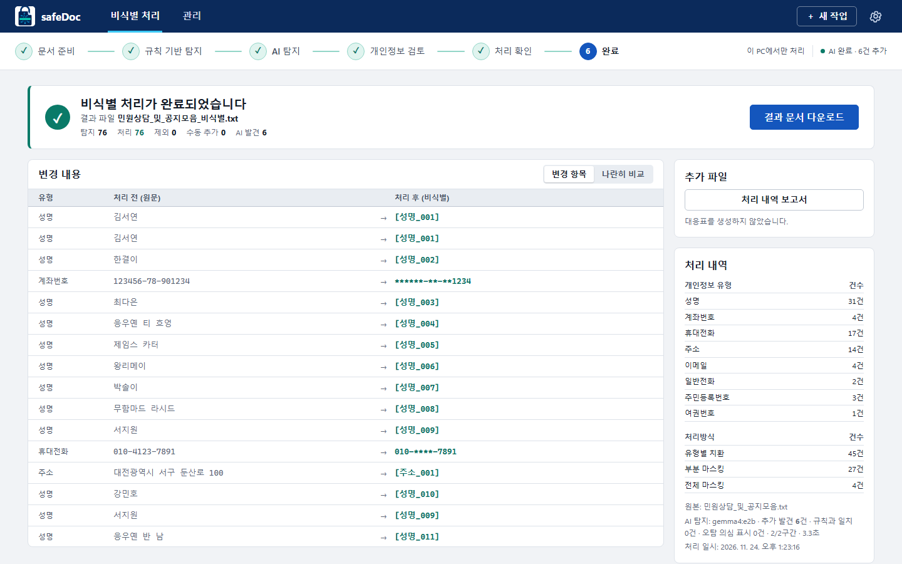
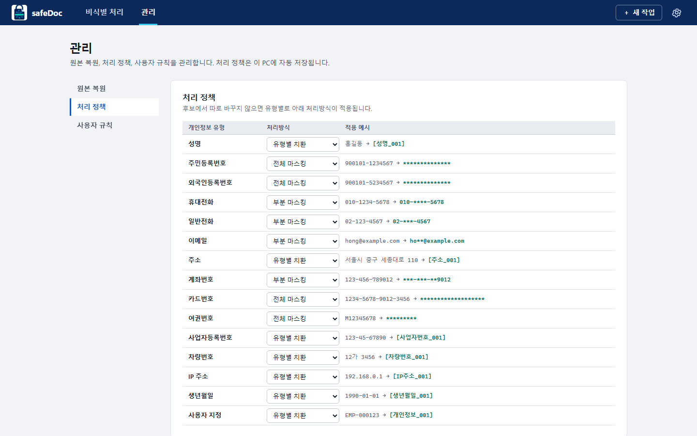
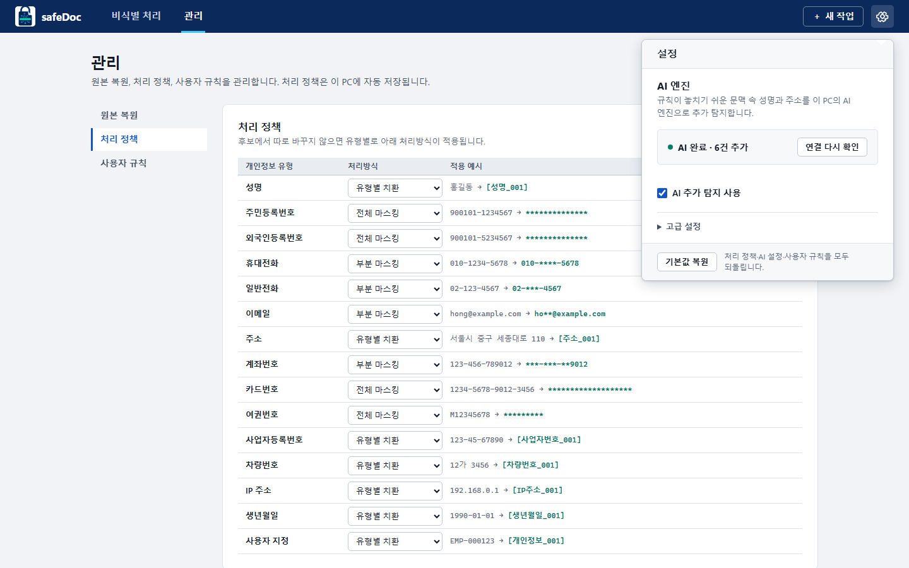

<p align="center">
  
</p>

# safeDoc

**safeDoc**은 문서 속 개인정보를 탐지하고 비식별 처리하는 **오프라인 업무 도구**입니다. 문서는 현재 PC 밖으로 나가지 않으며, 브라우저만으로 동작합니다. 규칙 기반 탐지에 로컬 소형 AI([Ollama](https://ollama.com/) · `gemma4:e2b`)를 보조로 결합해 정형 정보뿐 아니라 문맥 속 성명·주소까지 찾습니다.

탐지 결과를 자동으로 적용하지 않습니다. 모든 후보를 사람이 **처리 / 제외**로 판단한 뒤에만 결과 문서를 만들고, 원본 파일은 변경하지 않습니다.



---

## 1. 빠른 시작 (Windows)

프로젝트 루트의 배치 파일 두 개로 설치부터 실행까지 끝낼 수 있습니다.

### Step 1. 환경 설치 (`setup.bat`)

`setup.bat`을 더블클릭하면 다음을 확인하고 설치합니다.

1. **Node.js (v18 이상)** 확인 및 설치
2. **npm 패키지** 설치 (`npm ci` / `npm install`)
3. **단일 HTML 프로그램 빌드** (`dist/index.html`)
4. **로컬 AI 엔진(Ollama)** 확인 및 설치
5. **로컬 AI 모델 다운로드** (`gemma4:e2b`, 최초 1회 약 4.6GB)

> AI 없이 규칙 기반 탐지만 쓰려면 터미널에서 `setup.bat --skip-ai`를 실행하세요.
> 폐쇄망 PC에서는 인터넷이 되는 PC에서 받은 모델 폴더(`%USERPROFILE%\.ollama\models`)를 복사하면 오프라인에서도 AI 탐지를 사용할 수 있습니다.

### Step 2. 실행 (`start.bat`)

`start.bat`을 더블클릭하면 빌드 결과를 확인하고, 꺼져 있으면 Ollama를 기동한 뒤 `http://localhost:8080`을 기본 브라우저로 엽니다. 종료하려면 콘솔 창에서 `Ctrl + C`를 누르거나 창을 닫으세요.

> [!IMPORTANT]
> `dist/index.html`을 직접 더블클릭(`file://`)해서 열지 마세요. Ollama가 `file://` 출처 요청을 거부해 AI 탐지가 동작하지 않습니다. 반드시 `start.bat`으로 실행해 주세요.

### Step 3. 시험 문서로 동작 확인

저장소의 **`test\documents\`** 폴더(프로젝트 루트 기준)에 형식별 시험 문서 6종이 들어 있습니다. 실행한 화면에 파일을 끌어다 놓으면 처음부터 끝까지 시험해 볼 수 있습니다. 문서 속 이름·번호·주소는 모두 시험용 가상 정보입니다.

| 시험 문서 (`test\documents\`) | 형식 | 확인할 점 |
| :--- | :--- | :--- |
| `01_민원상담_및_공지모음.txt` | TXT | 문맥 속 성명, 변형 표기(`[at]`·한글 숫자·공백), 오탐 함정. 규칙 탐지 약 70건 |
| `02_외부인력_및_협력사명부.csv` | CSV | 열 제목으로 성명·연락처 구분, 외국인 성명 |
| `03_개인정보_실태점검_회의록.docx` | DOCX | 여러 조각으로 나뉜 글자, 표, 머리글. 규칙 탐지 약 68건 |
| `04_근태_및_인사기록.xlsx` | XLSX | 시트 2개, 숫자 칸에 든 주민번호·전화번호 |
| `05_업무협조_및_점검보고서.hwpx` | HWPX | 본문과 여러 표 |
| `06_개인정보_처리현황_보고서.pdf` | PDF | 텍스트 레이어, 표, 가림 처리 |

- 같은 문서를 `설정(톱니바퀴) › AI 추가 탐지 사용`을 껐다 켜며 두 번 돌리면 AI가 더 찾는 항목을 비교할 수 있습니다. `01`번에서는 규칙이 놓치는 `알렉산더 킴`, `오세훈`, `[at]` 표기 이메일 같은 값이 AI 탐지 대상입니다. 실제 모델의 결과는 실행마다 조금씩 다를 수 있습니다.
- 문서마다 심어 둔 사례의 설명은 `test\documents\정답지.md`에 있습니다. 시험 문서는 `npm run testdocs`로 다시 만들 수 있습니다.
- 배포판 ZIP에는 시험 문서가 들어 있지 않습니다. 폐쇄망 PC에서 시험하려면 이 폴더를 따로 복사해 가세요.

폐쇄망 무설치 배포판은 개발 PC에서 `npm run package`로 `release/safeDoc-v1.0.0.zip`을 만들 수 있습니다. 배포판은 Node.js 없이 압축을 풀고 동봉된 `start.bat`만 실행하면 됩니다.

---

## 2. 사용 방법

상단 메뉴는 **비식별 처리 · 관리** 두 가지이고, 오른쪽 위의 **톱니바퀴(설정)** 아이콘으로 팝업을 엽니다. 비식별 처리는 여섯 단계로 진행되며, 화면 오른쪽 아래의 주요 버튼이 항상 다음 행동입니다.

| 단계 | 하는 일 |
| :--- | :--- |
| 1. 문서 준비 | 파일을 끌어다 놓거나 선택합니다. 지원 형식과 처리 기준이 오른쪽에 표시됩니다. |
| 2. 규칙 기반 탐지 | 규칙 엔진이 주민번호·전화번호·계좌번호 같은 정형 정보를 추출합니다. |
| 3. AI 탐지 | 로컬 AI가 문맥 속 성명·주소를 추가로 찾습니다. 이 동안 검토 화면은 **읽기 전용**(보기·이동·필터만 가능)이며, `AI 탐지 중단`으로 끝낼 수 있습니다. AI를 쓰지 않거나 중단·사용 불가이면 이 단계는 `–`로 표시되고 바로 검토로 넘어갑니다. |
| 4. 개인정보 검토 | AI 탐지가 끝나면 열립니다. 왼쪽 문서와 오른쪽 후보 표를 나란히 보며 항목마다 **처리 / 제외**를 정합니다. |
| 5. 처리 확인 | 처리방식별·유형별 건수를 확인하고, 복원용 대응표 생성 여부를 고릅니다. |
| 6. 완료 | 결과 문서를 내려받고 변경 내용을 확인합니다. |

### AI 탐지 (3단계)



*이 문서의 화면 캡처는 결과가 매번 같도록 AI 응답을 고정한 모의 엔진으로 촬영했습니다. `AI 발견` 항목은 실제 모델의 결과가 아니라 화면 설명용 예시입니다.*

- 규칙 탐지 결과가 먼저 표시되고, AI 탐지가 이어서 진행됩니다. 위쪽 배너에 진행 상황(`추가 탐지 1/2 · 3건 발견`)이 보이고, 새로 찾은 후보는 `AI 발견` 표시와 함께 표에 추가됩니다.
- 이 단계에서는 화면이 **읽기 전용**입니다. 후보를 훑어보고 문서 위치를 확인할 수 있지만, 처리/제외 판단은 AI 탐지가 끝난 뒤(4단계)에 합니다. `AI 탐지 중단`을 누르면 중단하고 규칙 결과로 바로 검토합니다.
- AI 응답이 너무 길어 중간에 끊기면 구간을 반으로 나눠 다시 검사하고, 그래도 끝내지 못한 구간이 있으면 `AI 미완료`로 알립니다(사유와 검사한 구간 수 표시).
- **GPU가 없는 PC에서는 느립니다.** 문서 한 건에 수 분이 걸릴 수 있습니다. 기다리지 않으려면 설정에서 AI를 끄거나 중간에 중단하세요.

### 개인정보 검토



- 후보는 **검토 필요순**으로 정렬됩니다. 규칙이 놓친 AI 발견, 오탐 의심, 낮은 신뢰도 항목이 먼저 나옵니다.
- 미확인 후보가 남아 있으면 실행할 수 없습니다. 하단 버튼이 `미확인 N건 확인하기`로 바뀌며 누르면 그 항목만 모아 보여 줍니다.
- 표에서 후보를 고르면 문서의 해당 위치가 강조되고, 아래 상세 영역에서 유형과 처리방식을 바꾸고 결과 예시를 미리 볼 수 있습니다.
- 문서 본문을 드래그하면 그 자리에서 후보로 직접 추가할 수 있습니다. 누락된 값은 검색해 한 번에 지정할 수도 있습니다.
- 단축키: `J` / `K` 이동, `I` 처리, `X` 제외, `Ctrl+Z` 되돌리기. 판단하면 다음 미확인 후보로 자동 이동합니다.

### 처리 확인과 결과



대응표는 기본적으로 만들지 않습니다. 복원이 필요해 생성하는 경우 대응표에는 개인정보 원문이 평문으로 들어가므로 결과 문서와 분리 보관해야 합니다.



완료 화면의 `나란히 비교`에서는 처리 전·후 문서가 함께 스크롤됩니다.

### 관리



`관리` 메뉴에는 세 항목이 있습니다.

- **원본 복원**: 비식별 문서와 대응표를 고르면 일치 여부와 복원 가능·불가 건수를 확인한 뒤 복원합니다.
- **처리 정책**: 개인정보 유형별 기본 처리방식을 정합니다. 적용 예시가 함께 표시됩니다.
- **사용자 규칙**: 정규표현식으로 조직 고유 번호나 코드를 탐지하는 규칙을 추가합니다. 규칙은 프로그램을 닫으면 사라집니다.

### 설정 (톱니바퀴)



오른쪽 위 톱니바퀴를 누르면 팝업이 열립니다. 바깥을 누르거나 `Esc`를 누르면 닫힙니다.

- **AI 엔진**: 연결 상태 확인, AI 추가 탐지 사용 여부, 고급 설정(엔진 주소·모델).
- **기본값 복원**: 처리 정책, AI 설정, 사용자 규칙을 모두 처음 상태로 되돌립니다.

처리 정책과 AI 설정은 이 PC의 브라우저에 자동 저장되며 개인정보 원문은 저장하지 않습니다.

---

## 3. 지원 형식과 탐지 유형

| 항목 | 지원 내용 |
| :--- | :--- |
| **지원 문서** | `TXT`, `CSV`, `XLSX`, `DOCX`, `HWPX`, 텍스트 기반 `PDF` (최대 20MB)<br>*(구형 `.hwp`·`.doc`·`.xls`, 암호·DRM 문서, 스캔 이미지 PDF 제외)* |
| **탐지 유형**<br>*(14종 + 사용자 정의)* | 성명, 주민등록번호, 외국인등록번호, 생년월일, 휴대전화, 일반전화, 이메일, 주소, 계좌번호, 카드번호, 차량번호, 여권번호, 사업자등록번호, IP 주소, 사용자 정의 정규식 |
| **처리 방식** | 유형별 치환(`[성명_001]`), 부분 마스킹(`010-****-5678`), 전체 마스킹(`******`), 삭제 |

### 결과 파일 위생

- 원본 서식과 레이아웃을 유지한 채 텍스트만 치환합니다.
- **HWPX**: 한글이 저장 시 따로 넣는 미리보기 텍스트·이미지를 비우고, 문서 속성의 작성자·마지막 저장자를 지웁니다.
- **PDF**: 페이지를 이미지로 만들어 개인정보 영역을 불투명하게 가립니다. 결과 PDF에서 텍스트를 선택할 수 없습니다.
- 문서 제목·주제 같은 다른 문서 속성과 도형·개체 속에 들어 있는 텍스트는 처리 대상이 아닙니다. 외부 반출 전에 확인하세요.

### 탐지 정확도

자체 합성 평가 세트 32건(`npm run eval`) 기준입니다.

| | 재현율 | 정밀도 | F1 |
| :--- | :--- | :--- | :--- |
| 규칙 단독 | 100.0% | 97.3% | 98.6% |
| 규칙 + AI | 100.0% | 95.3% | 97.6% |

이 수치는 평가 세트에 한한 것이며 실제 문서의 성능을 보장하지 않습니다. 자동 탐지는 모든 개인정보를 찾지 못할 수 있으므로 **사람의 검토가 전제**입니다. AI는 후보를 추가만 하고 제거할 수 없으며, 그 결과 오탐이 조금 늘어날 수 있습니다.

---

## 4. 개발·테스트

```bash
npm run dev        # Vite 개발 서버
npm run build      # 단일 HTML 프로덕션 빌드 (dist/index.html)
npm test           # Vitest 단위 테스트
npm run eval       # 규칙 단독 탐지 정확도 평가
npm run eval:ai    # 규칙 vs 규칙+AI 비교 평가 (Ollama 필요)
npm run testdocs   # test/documents/ 시험 문서 6종 재생성
npm run package    # 폐쇄망 배포용 ZIP 생성 (release/)
```

> PowerShell 실행 정책으로 `npm`이 막히면 `npm.cmd`를 사용하세요.

시험 관련 파일 위치:

| 위치 | 내용 |
| :--- | :--- |
| `test\*.test.js`, `test\ai\*.test.js` | 단위 테스트(`npm test`) |
| `test\documents\` | 화면에서 직접 시험하는 형식별 문서 6종과 `정답지.md` |
| `test\fixtures\eval\cases.json` | 탐지 정확도 평가 세트 32건(`npm run eval`) |

문서 안내:

- [DEVELOPMENT_STATUS.md](DEVELOPMENT_STATUS.md) — 현재 상태, 설계 결정, 남은 과제
- [doc/UIUX_설계서.md](doc/UIUX_설계서.md) — 화면 구조와 디자인 시스템
- [ANALYSIS.md](ANALYSIS.md) — 코드베이스 결함 분석(2026-08-01 스냅샷)과 해결 현황
- [deploy/README.txt](deploy/README.txt) — 폐쇄망 배포판 설치 안내
- `doc/` — 요구사항 정의서·기술명세서 (PDF)
