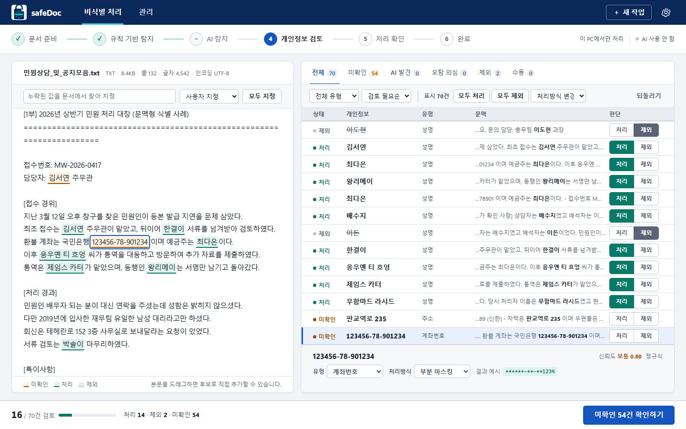

<p align="center">
  
</p>

# safeDoc

**safeDoc**은 **인터넷 연결 0%, 외부 전송 0%** 환경에서 브라우저만으로 문서 속 개인정보를 탐지하고 비식별 처리하는 로컬 AI 기반 오프라인 프로그램입니다. 규칙 기반 엔진과 로컬 소형 AI([Ollama](https://ollama.com/) · `gemma4:e2b`)를 결합해 정형 정보뿐 아니라 문맥 속 성명·주소까지 놓치지 않고 찾아냅니다.


---

## 1. 빠른 시작 (Windows 원클릭 설치 및 실행)

프로젝트 루트의 두 배치 파일만으로 초기 설치부터 실행까지 끝낼 수 있습니다.

### Step 1. 환경 자동 설치 (`setup.bat`)

프로젝트 루트 폴더에서 **`setup.bat`** 을 더블클릭하면 다음 항목을 자동으로 확인하고 설치합니다.

1. **Node.js (v18 이상)** 확인 및 자동 설치
2. **필수 npm 패키지** 설치 (`npm ci` / `npm install`)
3. **단일 HTML 프로그램 빌드** (`dist/index.html`)
4. **로컬 AI 엔진(Ollama)** 확인 및 자동 설치
5. **로컬 AI 모델 다운로드** (`gemma4:e2b`, 최초 1회 약 4.6GB)

> **참고**
> - AI 없이 규칙 기반 탐지만 빠르게 설치하려면 터미널에서 `setup.bat --skip-ai`를 실행하세요.
> - 완전 폐쇄망 PC에서는 인터넷이 되는 PC에서 내려받은 모델 폴더(`%USERPROFILE%\.ollama\models`)를 복사하면 오프라인에서도 AI 탐지를 사용할 수 있습니다.

### Step 2. 프로그램 실행 (`start.bat`)

설치가 끝난 뒤 프로젝트 루트에서 **`start.bat`** 을 더블클릭하면:

1. 빌드된 프로그램(`dist/index.html`)을 확인합니다.
2. 로컬 Ollama 서비스 상태를 확인하고, 꺼져 있으면 백그라운드에서 자동 기동합니다.
3. 로컬 웹 서버(`http://localhost:8080`)를 시작하고 **기본 웹 브라우저를 자동으로 엽니다.**
4. 사용이 끝나면 열린 콘솔 창에서 `Ctrl + C`를 누르거나 창을 닫으세요.

> [!IMPORTANT]
> **`dist/index.html`을 직접 더블클릭(`file://`)하여 열지 마세요.** Ollama 보안 정책상 `file://` 출처 요청이 거부되어 AI 문맥 탐지가 동작하지 않습니다. 반드시 `start.bat`으로 실행해 주세요.

*(폐쇄망 무설치 배포판이 필요하면 개발 PC에서 `npm run package`를 실행해 `release/safeDoc-v1.0.0.zip`을 생성할 수 있습니다. 배포판은 Node.js 없이 압축 해제 후 동봉된 `start.bat`으로 바로 실행됩니다.)*

---

## 2. 핵심 기능 및 사용 흐름

- **규칙 + 로컬 AI 하이브리드 탐지**: 정규식 엔진(재현율 92.3%)에 로컬 AI(`gemma4:e2b`) 문맥 탐지를 결합해 **100.0% 재현율**을 달성했습니다. AI는 후보를 추가만 하며 모든 추론은 PC 내부(`localhost:11434`)에서만 수행됩니다.
- **폐쇄망 보안 & 원본 보존**: 엄격한 CSP로 외부 통신을 원천 차단하며, 원본 파일은 변경하지 않고 새 비식별 파일로 저장합니다.
- **검토 중심 워크플로우 & 선택적 복원**: 모든 탐지 항목을 직접 확인한 뒤 처리하며, 필요 시 대응표(JSON)를 저장해 추후 원본으로 복원할 수 있습니다.

### 5단계 사용 방법

1. **문서 준비**: 비식별화할 파일을 화면에 드래그 & 드롭하거나 선택합니다.
2. **자동 분석**: 규칙 엔진이 정형 정보를 즉시 추출하고, 로컬 AI가 문맥 속 비정형 개인정보를 추가 탐지합니다.
3. **개인정보 검토**: 3열 화면에서 각 항목을 **[처리]** 또는 **[제외]**로 확정합니다. *(단축키: `J` 다음 / `K` 이전 / `I` 처리 / `X` 제외)*
4. **처리 확인**: 처리 방식과 복원용 대응표(JSON) 생성 여부를 선택합니다.
5. **완료**: 원본 형식 그대로 비식별 결과 문서(`*_deidentified.*`)를 다운로드합니다.



---

## 3. 지원 형식 및 탐지 유형

| 항목 | 지원 내용 |
| :--- | :--- |
| **지원 문서** | `TXT`, `CSV`, `XLSX`, `DOCX`, `HWPX`, 텍스트 기반 `PDF` (최대 20MB)<br>*(구형 `.hwp`, 암호화 문서, 스캔 이미지 PDF 제외)* |
| **탐지 유형**<br>*(14종 + 사용자 정의)* | 성명(한국인/외국인), 주민등록번호, 외국인등록번호, 생년월일, 휴대전화, 일반전화, 이메일, 주소, 계좌번호, 신용카드번호, 차량번호, 여권번호, 사업자등록번호, IP 주소, 사용자 정의 정규식 |
| **처리 방식** | 전체 마스킹(`******`), 부분 마스킹(`010-****-5678`), 유형 치환(`[성명_001]`) |

---

## 4. 개발·테스트 및 상세 문서

```bash
npm run dev        # Vite 개발 서버 실행
npm run build      # 단일 HTML 프로덕션 빌드 (dist/index.html)
npm test           # Vitest 단위 테스트 실행
npm run eval:ai    # 규칙 vs 규칙+AI 탐지 정확도 비교 평가
npm run package    # 폐쇄망 배포용 무설치 ZIP 생성 (release/)
```

자세한 아키텍처, 구현 내역 및 기술 분석은 [DEVELOPMENT_STATUS.md](DEVELOPMENT_STATUS.md)와 [ANALYSIS.md](ANALYSIS.md)를 참고하세요.
