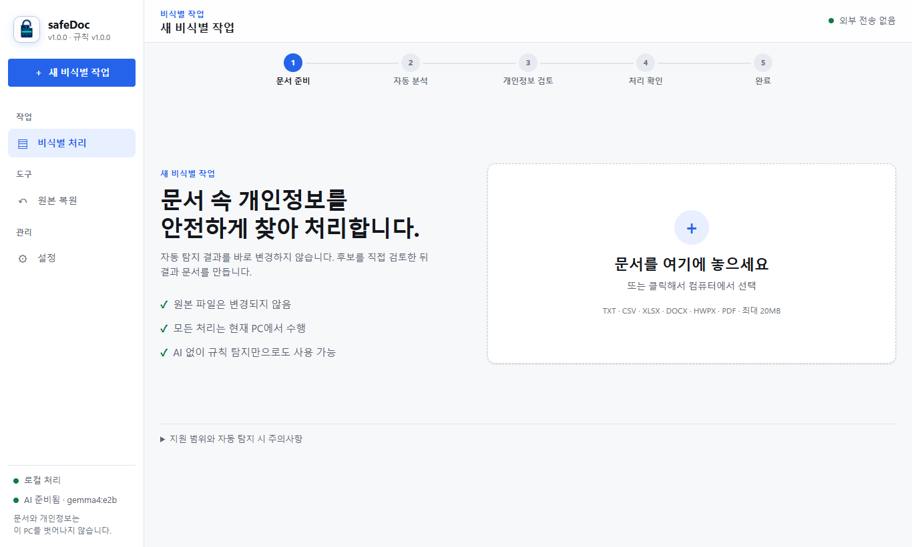
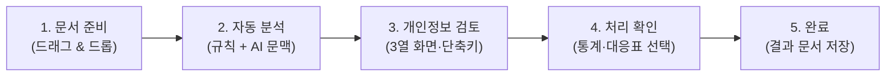
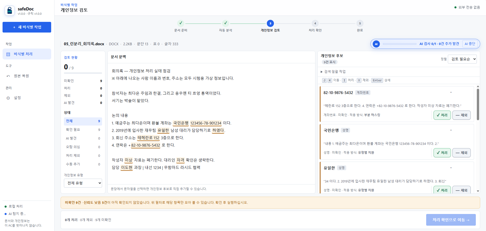
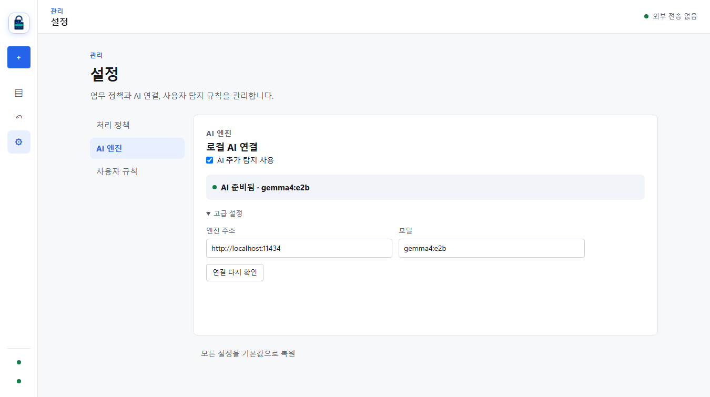
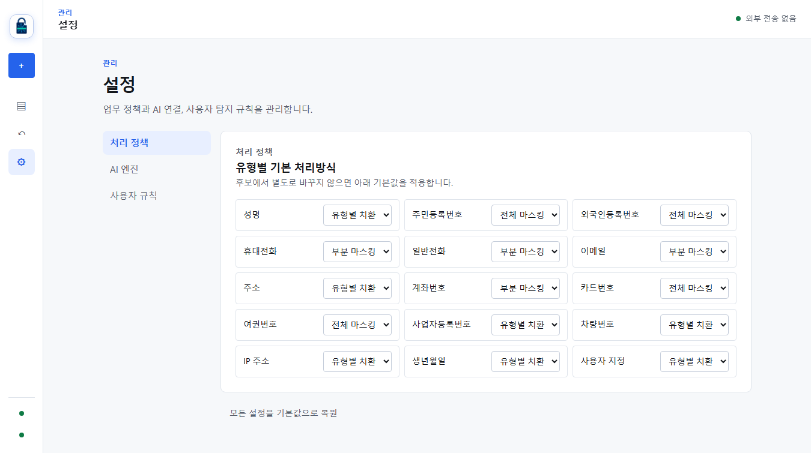
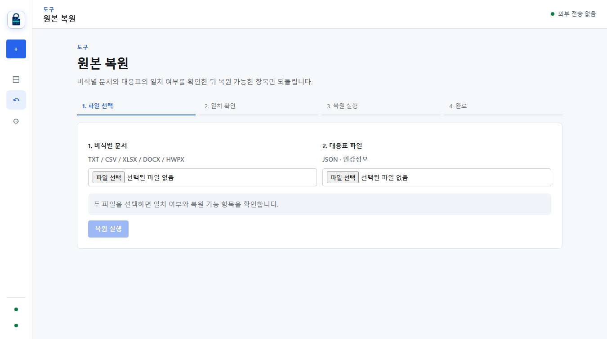

<p align="center">
  
</p>

# safeDoc — 로컬 AI 기반 오프라인 개인정보 비식별화 프로그램

> **인터넷 연결 0%, 외부 전송 0%** — 일반 PC 및 공공·금융 폐쇄망 환경에서 브라우저만으로 다양한 문서 속 개인정보를 안전하게 탐지하고 비식별 처리하는 도구입니다.

---

## 🌟 한눈에 보는 핵심 기능

safeDoc은 강력한 **규칙 기반 엔진**과 **로컬 소형 AI(LLM)**를 결합하여, 문서 내 정형 정보뿐 아니라 문맥에 숨겨진 비정형 개인정보까지 완벽하게 찾아냅니다.



### 1. 🤖 로컬 AI(LLM) 문맥 탐지 — 규칙이 놓치는 개인정보 완벽 포착
- **정규식의 한계 극복**: 단순 규칙으로는 찾기 힘든 서술형 문맥 속 성명(*"참석자는 최다은 주임과 한결, 응우옌..."*), 변형 표기, 외국인 이름, 상세 주소를 로컬 LLM([Ollama](https://ollama.com/) + `gemma4:e2b`)이 정밀하게 찾아냅니다.
- **압도적인 탐지 정확도**:
  - 규칙 엔진 단독: **92.3%** 재현율
  - **규칙 + 로컬 AI 결합 시**: **100.0% 재현율** 달성 *(합성 공문서 평가 세트 32건 기준)*
- **외부 유출 절대 불가 (100% 로컬 추론)**: 상용 클라우드 API를 쓰지 않고 **사용자 PC 안의 로컬 AI(`localhost:11434`)**에서만 추론하므로, 문서 내용이 네트워크를 타고 외부로 나가지 않습니다.
- **안전한 결합 아키텍처**: AI는 후보를 '추가'만 할 수 있으며, 정규 규칙이 이미 잡은 후보를 마음대로 삭제·해제할 수 없습니다. AI 환각(문서에 없는 단어 생성)은 자동으로 걸러내 폐기합니다.

### 2. 🔒 강력한 폐쇄망·오프라인 보안
- **엄격한 콘텐츠 보안 정책(CSP)**: 외부 통신이 원천 차단되어 공공기관·금융사 등 엄격한 망분리 환경에서도 안심하고 사용할 수 있습니다.
- **원본 보존 원칙**: 업로드한 원본 파일은 브라우저 메모리 안에서만 읽히며 전혀 변경되지 않습니다. 비식별화된 새 파일이 독립적으로 생성됩니다.

### 3. ⚡ 무설치 단일 HTML 실행 (Zero-Install)
- 모든 엔진과 라이브러리가 단 하나의 HTML 파일로 번들링되어 있습니다.
- 일반 사용자는 Node.js 설치 없이 동봉된 `start.bat` 더블클릭만으로 즉시 실행할 수 있습니다.

---

## 🚀 빠른 설치 및 시작하기

safeDoc은 **일반 사용자(무설치)**와 **개발자(소스코드)** 두 가지 방식으로 실행할 수 있습니다.

### 방법 1. 일반 사용자 (가장 쉬운 무설치 실행, 권장)

Node.js나 복잡한 개발 도구를 설치할 필요가 없습니다.

1. 배포 패키지(`safeDoc-v1.0.0.zip`) 압축을 해제합니다.
2. 폴더 안의 **`start.bat`을 더블클릭**합니다.
3. 기본 웹 브라우저가 열리며 `http://localhost:8080`으로 자동 접속됩니다.
4. 사용이 끝나면 실행된 검은 창을 닫거나 `Ctrl + C`를 누릅니다.

> [!IMPORTANT]
> **`dist/index.html` 파일을 더블클릭(`file://`)하여 직접 열지 마십시오.**  
> Ollama 보안 정책상 `file://` 출처의 요청이 거부되어 AI 문맥 탐지 기능이 동작하지 않습니다. 반드시 `start.bat`을 통해 실행해 주십시오. (규칙 탐지만 사용할 경우에는 직접 열어도 무방합니다.)

---

### 방법 2. AI 문맥 탐지 기능 활성화 (강력 추천!)

safeDoc은 AI 없이도 규칙 엔진만으로 훌륭하게 동작하지만, **로컬 AI를 켜면 탐지 정확도가 대폭 향상(재현율 100%)**됩니다.

1. **Ollama 설치**: [Ollama 공식 홈페이지](https://ollama.com/)에서 설치 프로그램을 받아 설치합니다.
2. **AI 모델 다운로드**: 명령 프롬프트(cmd) 또는 터미널을 열고 다음 명령어를 입력합니다:
   ```bash
   ollama pull gemma4:e2b
   ```
   *(약 3GB 용량의 고성능 소형 한국어 문맥 모델이 다운로드됩니다.)*
3. **실행**: Ollama가 백그라운드에 켜진 상태에서 `start.bat`을 실행하면 safeDoc이 AI 엔진을 자동 감지하여 연결합니다! (화면 좌측 하단에 `AI 준비됨 · gemma4:e2b` 녹색 불이 켜집니다.)

> [!TIP]
> **인터넷이 안 되는 완전 폐쇄망 PC인 경우**:  
> 인터넷이 되는 PC에서 `ollama pull gemma4:e2b`를 실행한 후, 모델 저장 폴더(`%USERPROFILE%\.ollama\models`)를 USB 등으로 폐쇄망 PC에 그대로 복사해 넣으면 오프라인에서도 AI를 사용할 수 있습니다.

---

### 방법 3. 개발자 환경 (소스코드 빌드 & 실행)

개발 및 커스터마이징을 원할 경우 Node.js 18 이상 환경에서 진행합니다.

```bash
# 1. 의존성 설치
npm install

# 2. 로컬 개발 서버 실행 (실시간 갱신)
npm run dev

# 3. 단일 HTML 프로덕션 빌드
npm run build

# 4. 배포용 단일 실행 패키지 생성 (release/ 폴더에 zip 생성)
npm run package
```

---

## 📖 5단계 초간단 사용 가이드

safeDoc의 직관적인 5단계 워크플로우를 따라 누구나 손쉽게 비식별 처리를 완료할 수 있습니다.



### 1단계: 문서 준비
- 비식별화할 문서를 화면 중앙의 상자에 **끌어다 놓거나(Drag & Drop)**, 클릭하여 파일을 선택합니다.
- 지원 형식: **TXT, CSV, XLSX(엑셀), DOCX(워드), HWPX(한글), PDF(텍스트 기반)** (최대 20MB)

### 2단계: 자동 분석
- 문서가 로드되면 정규식 엔진이 1차 정형 정보를 즉시 추출하고, 백그라운드에서 로컬 AI가 문맥 속 비정형 개인정보를 추가로 분석합니다.

### 3단계: 개인정보 검토 (핵심 작업!)
사용자의 확인 없는 자동 치환은 오탐이나 누락의 위험이 있습니다. 3열 검토 화면에서 확실하게 검토합니다.



- **좌측 (검토 현황 & 필터)**: 전체 후보 수, 미확인 항목 수, `AI 발견` 필터, `오탐 의심` 필터를 클릭해 집중 검토할 수 있습니다.
- **중앙 (문서 문맥)**: 원문에서 탐지된 위치가 색상별로 하이라이트 표시됩니다. 드래그하여 새로운 개인정보를 수동 추가할 수도 있습니다.
- **우측 (후보 목록 카드)**:
  - 각 후보를 보고 **[✓ 처리]** 또는 **[— 제외]** 버튼을 누릅니다.
  - ⚡ **빠른 키보드 단축키 지원**: `J` (다음 카드), `K` (이전 카드), `I` (처리), `X` (제외)
  - **AI 발견 배지**: 로컬 AI가 문맥으로 찾아낸 항목에는 파란색 AI 배지가 표시됩니다.
- 모든 후보를 검토(미확인 0건)해야 다음 단계로 안전하게 넘어갈 수 있습니다.

### 4단계: 처리 확인
- 비식별 처리될 항목 수와 방식(전체 가림, 부분 가림, 유형 치환)을 최종 확인합니다.
- **복원용 대응표 생성 여부 선택**:
  - **생성하지 않음 (권장)**: 영구적인 비식별 처리를 원할 때 선택합니다.
  - **복원을 위해 생성**: 향후 원본 복원이 필요할 때 암호화된 대응표(JSON)를 함께 다운로드합니다.

### 5단계: 완료 및 결과 다운로드
- **[결과 문서 다운로드]**를 눌러 안전하게 비식별 처리된 결과 파일을 받습니다.
- 원본 확장자 그대로 저장되며(예: `.xlsx` → `_deidentified.xlsx`), 전/후 텍스트 비교 및 처리 내역 감사 보고서를 함께 제공합니다.

---

## 🔍 AI 기반 개인정보 탐지 기능 심층 비교

safeDoc은 단순 키워드 매칭이나 정규표현식만으로는 해결할 수 없는 **실제 업무 문서의 난제**를 로컬 AI로 해결합니다.

| 구분 | 일반 규칙 탐지 | safeDoc (규칙 + 로컬 AI) | AI 기여 효과 |
| :--- | :---: | :---: | :--- |
| **정형 정보** (주민번호, 계좌, 이메일, 전화번호) | ✅ 완벽 탐지 | ✅ 완벽 탐지 | 알고리즘 및 체크섬 교차 검증 |
| **한국어 인명** (성명 표기) | ⚠️ "성명: 홍길동" 등 정형 패턴 위주 | ✅ 문맥 속 이름 완벽 탐지 | *"서기는 박솔이 맡았다"* 등 문맥 서술형 인명 포착 |
| **외국인 이름** (다문화/해외 인력) | ❌ 성씨 사전 한계로 탐지 불가 | ✅ **완벽 탐지** | *"응우옌 티 흐엉", "무함마드 라시드"* 포착 |
| **비정형 주소 및 변형 표기** | ⚠️ 행정구역 규칙 누락 발생 | ✅ **자연스러운 주소 탐지** | *"테헤란로 152 3층"* 등 축약/상세 주소 포착 |
| **평가 세트 재현율(Recall)** | 92.3% | **100.0%** | 누락 위험 완벽 차단 |

### AI 엔진 설정 및 상태 관리
사이드바의 **[설정] → [AI 엔진]** 탭에서 연결 상태를 확인하고 모델을 맞춤 설정할 수 있습니다.



- **AI 켜기/끄기 원클릭 스위치** 제공
- 연결 상태 실시간 진단 (엔진 연결 여부 및 모델 준비 상태)
- 자체 구축 Ollama 서버가 있을 경우 엔드포인트 커스텀 지정 가능

---

## 🛠️ 추가 기능

### 1. 유형별 처리 정책 설정
사이드바 [설정] → [처리 정책]에서 개인정보 유형별로 원하는 기본 처리 방식을 지정할 수 있습니다.
- **전체 마스킹 (`MASK_ALL`)**: `******` 형태로 완전히 가림 (예: 주민번호, 여권번호)
- **부분 마스킹 (`MASK_PART`)**: 앞/뒤 일부만 남기고 가운데 가림 (예: `010-****-5678`)
- **유형별 치환 (`REPLACE`)**: 문맥을 보존하기 위해 `[성명_001]`, `[주소_001]` 형태의 고유 토큰으로 변경



### 2. 안전한 원본 복원 (선택 기능)
비식별 처리 시 대응표를 다운로드해 두었다면, 사이드바 **[원본 복원]** 메뉴에서 비식별 파일과 대응표 JSON을 업로드하여 언제든지 원래 문서로 되돌릴 수 있습니다.



---

## 📊 지원 형식 및 탐지 개인정보 유형

### 지원 문서 형식
| 형식 | 확장자 | 특징 |
| :--- | :---: | :--- |
| **일반 텍스트** | `.txt` | UTF-8, EUC-KR 등 다양한 인코딩 자동 판별 |
| **CSV 데이터** | `.csv` | 쉼표 구분 및 비정형 헤더 자동 분석 |
| **엑셀 시트** | `.xlsx` | 서식 셀뿐만 아니라 원시 숫자 셀(`<v>`) 속 번호까지 완벽 스캔 |
| **워드 문서** | `.docx` | 문단, 표, 런 분리 구조 보존 |
| **한글 문서** | `.hwpx` | 최신 개방형 한글 규격 준수 (무압축 mimetype 유지) |
| **PDF 문서** | `.pdf` | 텍스트 기반 PDF 내 좌표 계산 및 원문 텍스트 완전 제거 |

*(최대 파일 용량: 20MB / 구형 HWP, 암호화 문서, 스캔 이미지 PDF는 지원 제외)*

### 탐지 가능한 개인정보 (14종 + 사용자 정의)
- **신원 정보**: 성명(한국인/외국인), 주민등록번호, 외국인등록번호, 생년월일
- **연락처 정보**: 휴대전화, 일반전화, 이메일, 주소
- **금융 및 자산**: 계좌번호, 신용카드번호, 차량번호
- **식별 및 전산**: 여권번호, 사업자등록번호, IP 주소
- **사용자 정의**: 정규표현식을 이용한 조직 고유 번호(사번, 학번, 고객ID 등)

---

## ❓ 자주 묻는 질문 (FAQ)

<details>
<summary><b>Q. 인터넷이 완전히 차단된 업무망(폐쇄망)에서도 동작하나요?</b></summary>
<div markdown="1">

**네, 완벽하게 동작합니다.**  
safeDoc은 단 하나의 외부 인터넷 연결도 시도하지 않으며 브라우저 보안 정책(CSP)으로도 차단되어 있습니다. 배포 ZIP 파일에 Windows 기본 내장 기능으로 구동되는 독립형 로컬 웹 서버(`serve.ps1`)가 포함되어 있어, 외부 라이브러리 다운로드 없이 오프라인에서 즉시 실행됩니다.
</div>
</details>

<details>
<summary><b>Q. 고사양 그래픽카드(GPU)가 없는 사무용 PC에서도 AI를 쓸 수 있나요?</b></summary>
<div markdown="1">

**네, 일반 사무용 PC(CPU 전용)에서도 충분히 사용할 수 있습니다.**  
채택된 `gemma4:e2b`는 약 2~3GB 내외의 메모리만 사용하는 초경량 고효율 모델입니다. GPU가 없더라도 일반 4코어~8코어 CPU 환경에서 수 초 내외로 청크별 문맥 분석을 완료합니다.
</div>
</details>

<details>
<summary><b>Q. 원본 파일이 덮어쓰여 손상될 위험은 없나요?</b></summary>
<div markdown="1">

**전혀 없습니다.**  
safeDoc은 원본 파일을 브라우저 메모리에 읽어들이기만 하며, 디스크의 원본 파일을 덮어쓰지 않습니다. 모든 결과물은 다운로드 폴더에 새로운 파일명(예: `파일명_deidentified.docx`)으로 안전하게 저장됩니다.
</div>
</details>

<details>
<summary><b>Q. 구형 한글 문서(.hwp)는 왜 지원하지 않나요?</b></summary>
<div markdown="1">

구형 `.hwp`는 20여 년 전의 복잡한 독점 바이너리 포맷으로 외부 변환 서버 없이 순수 브라우저 안에서 안전하게 처리하기 어렵습니다. 한글과컴퓨터 및 정부 표준 개방형 포맷인 `.hwpx`로 저장한 뒤 safeDoc에 넣어주시면 원형 그대로 안전하게 처리됩니다.
</div>
</details>

---

## 💻 개발자 및 프로젝트 정보

### npm 명령어 모음
```bash
npm run dev        # Vite 개발 서버 실행
npm run build      # SingleFile 번들 프로덕션 빌드 (dist/index.html)
npm test           # Vitest 단위 시험 (188개 테스트 전원 통과)
npm run eval       # 규칙 엔진 단독 정확도 평가
npm run eval:ai    # 규칙 vs 규칙+AI 하이브리드 정확도 비교 평가
npm run package    # 폐쇄망 배포용 무설치 ZIP 아카이브 생성
```

### 기술 스택
- **런타임 & 빌드**: Pure JavaScript (No Framework), [Vite](https://vitejs.dev/) + `vite-plugin-singlefile`
- **로컬 AI 엔진**: [Ollama](https://ollama.com/) (`gemma4:e2b`)
- **문서 파서**: `fflate` (ZIP 계열 오피스 문서), `pdfjs-dist` & `pdf-lib` (PDF 분석 및 수정)
- **테스트 프레임워크**: [Vitest](https://vitest.dev/) (19개 테스트 파일, 188개 단위 시험)

---

## 📄 라이선스

본 프로젝트의 소스코드는 안전하고 투명한 개인정보 보호를 위해 관리됩니다.
자세한 개발 내역 및 기술 분석 보고서는 [DEVELOPMENT_STATUS.md](DEVELOPMENT_STATUS.md) 및 [ANALYSIS.md](ANALYSIS.md)를 참고하십시오.
